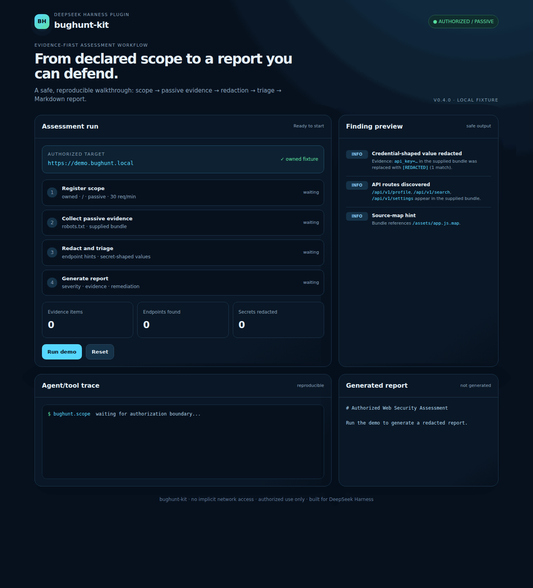

# bughunt-kit

> Portfolio project by [@0xmrxp](https://github.com/0xmrxp), built for DeepSeek Harness plugin development.

[](https://github.com/0xmrxp/bughunt-kit/actions/workflows/ci.yml)
[](https://github.com/topics/dsh-plugin)
[](LICENSE)

Authorized web security assessment workflows for [DeepSeek Harness](https://github.com/deepseek-ai/deepseek-harness).

> **Authorized use only.** Use this plugin only against systems you own, systems covered by written permission, or assets explicitly in scope for a bug-bounty program.

## Why this project

`bughunt-kit` is an evidence-first DSH plugin for turning an authorized assessment into a scoped, reproducible, redacted report. The first release intentionally favors safe passive analysis over exploit automation.

## Demo

The repository includes a reproducible local fixture and a browser-recorded walkthrough:



The demo shows the complete safe path: an owned local fixture, passive scope registration, evidence collection, redaction, endpoint triage, and Markdown report generation. It does not probe a public target and contains no exploit payloads.

Try it locally:

```bash
npm run demo:serve
# open http://127.0.0.1:18080 in a browser
# click "Run demo"
```

## What v0.4 provides

A built-in DSH Web panel, registered directly inside the Harness sidebar:

- Live assessment dashboard in DSH — no separate port or application.
- Every tool run is recorded into an in-memory store; the panel reads it through the `/bughunt.dashboard` host command.
- Responsive layout: 4-column stats collapse to 2 columns under 760px, tool/skill cards stack under 1080px.
- Defensive UI only: run counts, tool inventory, recent runs, and the latest report preview. No automatic probing, wallet signing, RPC, or transaction broadcast.
- Client bundle follows the official `window.__ModuleLoader__.load({ id, factory })` contract with `locale` registration and `remote.commands` + `sessions` injection.

Open the **BH** entry in the sidebar after restarting the Web profile. If the panel shows no activity, run `bughunt.scope` or `bughunt.report` in a session first — the store is process-local and starts empty on every boot.

Everything from v0.1 through v0.3 remains available:

- `bughunt.scope`: declare authorization, target paths, mode, and request budget.
- `bughunt.analyze-js`: extract endpoint and source-map hints from supplied JavaScript.
- `bughunt.openapi-inventory`: inventory a supplied OpenAPI 3 document without fetching.
- `bughunt.decode-calldata`: decode common EVM selectors and arguments locally.
- `bughunt.approval-risk`: explain ERC-20 and ERC-721 approval exposure.
- `bughunt.contract-review`: return a defensive smart-contract checklist.
- `bughunt.report`: render collected evidence into Markdown.
- Five bundled skills: authorization, evidence triage, API inventory, Web3 review, and reporting.
- Secret-shaped values are redacted before analysis output is returned.

## Install from a checkout

```bash
dsh plugin --profile web add ./bughunt-kit
```

After installation, restart the DSH profile or use the host's plugin reload action.

## Example workflow

```text
Use the bughunt-authorized-assessment skill. The target is my local demo fixture.
Register a passive scope, analyze the supplied JavaScript bundle, and produce a
redacted Markdown report. Do not send requests outside the declared scope.
```

The tools are deliberately narrow. `bughunt.analyze-js` accepts text; it does not download a URL or execute JavaScript. Network reconnaissance and browser workflows should be explicitly composed by the user with a separate authorized tool and a declared scope.

## Architecture

```text
scope declaration
      ↓
passive evidence supplied by the user
      ↓
redaction + structured triage
      ↓
severity-ranked Markdown report
```

The Cordis bundle is additive. It registers tools and a skill provider without modifying DSH core configuration.

## Development

```bash
npm install
npm test
npm run typecheck
npm run smoke
npm pack --dry-run
```

Every push and pull request runs the same checks in GitHub Actions: typecheck, tests, package smoke test, and SKILL.md frontmatter validation.

The package declares `dsh.bundle.patch`, so a published package can be installed with:

```bash
dsh plugin --profile web add bughunt-kit
```

## Compatibility

The initial scaffold targets DSH `0.2.1-rc.2` and Node.js 20+. Update the compatibility matrix and run the smoke test before each release.

## License

MIT. See [LICENSE](LICENSE) and [SECURITY.md](SECURITY.md).
